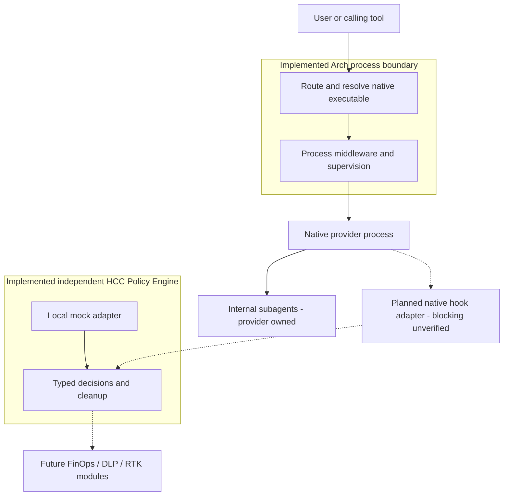

# Arch - HCC Harness

Arch is a project-scoped harness for existing command-line tools. It routes an OS
process invocation through trusted local middleware, resolves the native executable,
and supervises its direct child while preserving arguments, cwd, inherited terminal
streams and supported exit/signal behavior. Its independent HCC Policy Engine can
also evaluate typed provider requests through a **local mock adapter**. Arch is not
a universal agent orchestrator: native providers retain their models, internal
orchestration and in-process subagents.



Solid connections show implemented paths. Dotted connections are planned integrations;
no native Claude, Codex or Gemini policy enforcement is established by the mock.
The internal-subagent box is a logical provider operation, not a child OS process.

## Capabilities and limits

- Explicit dispatch and cooperative project-local PATH routing; nearest-ancestor
  middleware configuration; independent lifecycle and identity for each routed invocation.
- Stable snapshot installation with separate Arch and native-provider runtime selection;
  ownership-checked route updates, removal and checkpoint recovery.
- Process phases `preflight`, `prepareLaunch`, `finalize`; separate observational events
  and provider policy decisions, including required policies and cooperative deadlines.
- Only routed invocations enter Arch. Absolute native paths, unactivated shells and
  provider-owned internal delegation can bypass it. PATH routing is not a security boundary.
- No automatic descendant supervision, provider SDK, model loop, credential management,
  runtime downloader, daemon, remote telemetry or production FinOps/DLP/RTK module.

## Quick start

Requires Node **>=24.15.0 <25**. From this checkout:

```sh
npm run bootstrap
npm run install:stable -- --destination /absolute/user-owned/arch
ARCH_NODE=/absolute/compatible/node /absolute/user-owned/arch/arch --help
```

The destination must not exist; its parent must already be a real directory.
Installation does not edit PATH or profiles. Put the installed entry on your chosen
PATH or invoke it by absolute path. On Windows x64 use `arch.exe` and an absolute
Windows destination; PowerShell 5 needs `npm.cmd`. Building requires Visual C++ and
a complete Windows SDK (`ARCH_WINDOWS_SDK` can select an installed SDK).
The [runtime guide](docs/runtime-portability.md#stable-installation-contract) explains
selection, retained failed installations and development `npm link`.

From the intended consumer project root, using that installed `arch`:

```sh
arch init claude codex
arch status
arch run claude -- --help       # explicit routing
mise exec -- codex --help       # activate project routing for this subprocess
```

Tools must already be installed. Plain `claude`/`codex` requires mise trust,
[shell activation](https://mise.jdx.dev/shell-setup.html) and prompt refresh.
`initialized` status does not prove shell activation. Provider tool shells may reset PATH.

## Middleware and route management

New `.arch/harness.toml` starters have no enabled middleware. Explicit demo opt-in:

```toml
schema = 1

[[middleware]]
id = "demo"
enabled = true
```

`ARCH_TRACE=1` emits local lifecycle diagnostics; `ARCH_DEMO_DENY=1` denies a demo
process launch. This does not deny a provider's internal subagent operation.
See [policy contracts and a fictional module example](docs/provider-policy.md)
for the separate mock decision channel.

```sh
arch configure claude gemini
arch route add codex
arch route remove gemini
arch status --json
arch deinit --yes
```

Manage routes from the project root. Preserve modified managed files and interrupted
operation evidence; use [recovery guidance](docs/usage.md) before retrying.

## Implementation and validation status

Baseline: main `b562cbf`; [#24](https://github.com/Nickshajtan/hcc-harness/pull/24)
(F1-F5), [#26](https://github.com/Nickshajtan/hcc-harness/pull/26) (Windows test PTY)
and [#27](https://github.com/Nickshajtan/hcc-harness/pull/27) (policy VS1/H1-H5)
are merged. Stable installation is implemented; B1 is historical feasibility,
not the current feature ceiling. Real provider **process routing** has conditional
consumer evidence; native provider **policy enforcement** remains unimplemented.

Windows 10 acceptance is environment-limited; active-Avast compatibility remains
open. Targeted Ubuntu WSL2/ext4 process acceptance passed at its recorded revision.
Provider TUI, quoting and restricted child-sandbox gaps remain provider/platform-specific.
Windows PTY hardening is test infrastructure, not production interception. These
results do not establish universal compatibility or release readiness.

- [Documentation map](docs/README.md)
- [Canonical architecture and execution boundaries](docs/architecture.md)
- [Verified capabilities and guarantee boundaries](docs/capabilities.md)
- [Usage, configuration and recovery](docs/usage.md)
- [Compatibility and outstanding limitations](docs/compatibility.md)
- [Provider policy API and mock transport](docs/provider-policy.md)
- [Architecture decisions](docs/decisions/README.md)
- [Validation index and original reports](docs/validation/README.md)
- [Testing](docs/testing.md) and [engineering standards](docs/standards/README.md)
