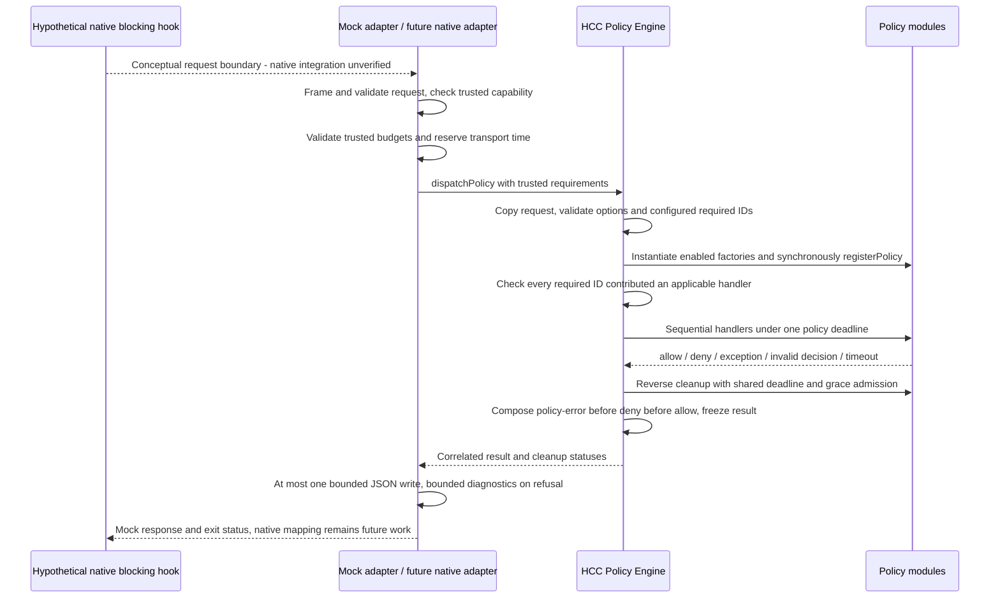
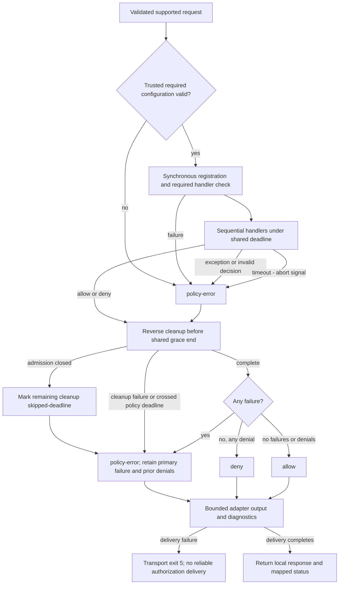

# Provider policy dispatch and mock adapter

Canonical API guide for merged PR #27 through H1-H5 (`3f6aa20`, merge `87c3480`).
Contracts: [policy types](../src/policy-contract.ts), [engine](../src/policy.ts),
[deadline](../src/policy-deadline.ts), [mock adapter](../src/mock-provider.ts),
[transport](../src/mock-transport.ts). Native Claude/Codex/Gemini adapters and
blocking enforcement are **not implemented or verified** by this vertical slice.
See [capabilities](capabilities.md) for evidence scope.

Process middleware still uses `register(api)`, `ExecutionContext`, hookable phases
`preflight -> prepareLaunch -> native -> finalize`, and execution-local cleanup.
Only `prepareLaunch` permits environment changes. None of those runtime paths changed.

Provider policy middleware optionally implements `ArchMiddleware.registerPolicy(api)`.
Its API has typed `on('agent.beforeSpawn', handler)` and `cleanup(handler)` methods,
with no execution context, environment mutation, process phases or EventBus.
A module may implement both registration methods; dispatch invokes only the relevant
one. The separate registration method avoids inventing an execution context for a
native provider hook and leaves existing modules source compatible.

```ts
const policy: ArchMiddleware = {
  id: 'delegation-policy',
  register: () => undefined,
  registerPolicy(api) {
    api.on('agent.beforeSpawn', (request) => {
      if ('premium' === request.requestedModel) {
        return { action: 'deny', reason: 'Premium subagent requires approval' };
      }
      return { action: 'allow' };
    });
  },
};
```

`premium` and `economy` are fictional example model labels, not engine rules.
Unknown model information stays absent. This demonstration policy is not production
FinOps and is never enabled in generated configuration or the default registry.

## Engine contract

`dispatchPolicy(input, configuration, registry, options?)` in `src/policy.ts` accepts unknown
input, an explicit configured middleware list, and the existing factory registry.
An adapter can pass an already parsed `Configuration` without project initialization.
The engine itself performs no discovery, filesystem writes, native resolution or
launches. Disabled entries do not instantiate; enabled entries instantiate in
configuration order. Process-only modules contribute no policy handlers.
Without `requiredPolicies`, no handlers means allow for a valid, supported event
within the deadline. This preserves optional/advisory behavior; it is not a security
guarantee. Mandatory enforcement requires explicit trusted requirements:

```ts
const result = await dispatchPolicy(request, configuration, registry, {
  requiredPolicies: ['delegation-budget'],
  timeoutMs: 5000,
  cleanupGraceMs: 100,
});
```

Requirements come from local configuration/adapter code, never request fields or
correlation IDs. Every required ID must be configured, enabled, present in the
factory registry, instantiated with the correct ID, synchronously registered, and
contribute at least one `agent.beforeSpawn` handler. An absent/disabled policy or a
process-only/no-handler module produces `policy-error` with `configuration-error`;
no handlers execute. Duplicate requirements or middleware entries are configuration
errors too. There is no dependency graph or global requirement registry.
At most 64 distinct requirements are accepted; IDs follow the existing lowercase
middleware ID syntax. The engine snapshots entries/requirements per request.

For example, an empty configuration plus `requiredPolicies: ['delegation-budget']`
fails closed with that ID at stage `configuration`, rather than authorizing an
economy or premium delegation. All required handler presence checks finish before
the first policy handler starts.

The flat request requires `type: 'agent.beforeSpawn'`, `requestId`, and `provider`.
Optional strings are `executionId`, `agentId`, `parentAgentId`, `requestedModel`,
and `agentType`. Strings must be nonempty, at most 256 UTF-16 code units and contain
no ASCII control characters. Unknown keys, unknown event types, nulls and nonstrings
are rejected. Validation copies and freezes the payload before registration.

`requestId` correlates one dispatch response; it is not a durable deduplication key.
Repeated requests dispatch independently. Execution IDs, agent IDs, parent IDs and
provider names are all untrusted correlation/description, not authenticated identity
or authorization. No identifiers or model names are generated. A native subagent
inside a provider process does not create an Arch execution: the provider owns its
agent spawning, models and orchestration. Arch still supervises only its routed
native process. There is no universal agent tree or persisted accounting model.

Policy registration is strictly synchronous and must return `undefined`. Async work
belongs inside handlers. Every other return, including Promises and thenables, is
a `registration-contract` failure. Genuine returned Promises receive rejection
observers (using the intrinsic Promise method); arbitrary thenables are never
inspected or invoked. Their `then` getters cannot suspend registration. The engine
does not await invalid async registration. Partially registered cleanup still runs;
handlers never run after registration failure. The per-module registration window
closes immediately when its registration call returns or throws.

```ts
// Invalid: produces policy-error/registration-contract, never allow.
registerPolicy: async (api) => {
  await loadPolicyState();
  api.on('agent.beforeSpawn', () => ({ action: 'allow' }));
};
// Correct: registration is synchronous; asynchronous work is inside the handler.
registerPolicy: (api) => {
  api.on('agent.beforeSpawn', async (request) => {
    const state = await loadPolicyState(request, api.signal);
    return evaluate(state, request);
  });
};
```

Handlers run sequentially in registration order. Every explicit denial is retained
with its middleware ID and reason in that order; later allows cannot erase it.
Decisions are exactly allow or deny with a bounded reason. Invalid returns and thrown
values produce `policy-error` and stop subsequent handlers. Registration failures
also fail closed. Cleanup runs once in reverse registration order on every allocated
dispatch, including partial registration. Cleanup errors block an allow and append
after the primary error without discarding prior denials or exception identity.
The single returned result distinguishes `invalid-request`, `allow`, `deny`, and
`policy-error`. Each failure has `stage`, `code`, middleware ID and a local raw
`cause`. Failure metadata, arrays and the final result are frozen; raw cause objects
are retained by identity, not recursively frozen or serialized.

Lifecycle state and cleanup lists belong to one dispatch; concurrent requests share
neither. Handlers may register cleanup before timeout, but cleanup cannot append
more cleanup. Closed or cancelled dispatches reject late handler/cleanup registration.

## Deadlines, cancellation and failure precedence

One monotonic deadline covers registration, all handlers and cleanup. The default
is 5000 ms; `timeoutMs` must be an integer in 1–60000. `cleanupGraceMs` defaults to
100 ms and must be an integer in 1–1000. Nulls, nonnumbers, fractions and out-of-range
values are configuration errors. No handler receives a fresh full timeout budget.
The mock executable supplies its own required demo policy and these default limits.

The additive optional `PolicyAPI.signal` is supplied by this dispatcher. It aborts
when the overall deadline expires, including during cleanup. Middleware should
cooperate with the signal and check `signal.aborted` before registering abort
listeners. A handler that never settles produces `policy-error`, failure code
`timeout`, stage `handler`, and the current middleware ID. Later handlers do not
start; prior denials remain in the result. Catching cancellation and returning allow
does not recover from timeout. Late fulfillments/rejections cannot change the result
and have rejection continuations attached to avoid unhandled rejections.

```ts
registerPolicy(api) {
  api.on('agent.beforeSpawn', () => new Promise(() => undefined));
}
// With timeoutMs: 20, this handler yields a timeout refusal, not an indefinite await.
```

Cleanup admission is checked in `PolicyDeadline` immediately before each callback
could start. Cleanup runs in reverse registration order and shares the original
budget plus one overall cleanup grace interval, not a new interval per callback.
If cleanup crosses the original deadline, the result fails closed even if cleanup
finishes during grace. After handler timeout, cooperative cleanup may finish during
grace without erasing the primary timeout. Rejections and cleanup timeouts append
as secondary failures. Grace is the fixed interval from `dispatch start + timeoutMs`
through `dispatch start + timeoutMs + cleanupGraceMs`, even when handlers finish
early. At the exact grace end, admission closes: no additional callback is invoked,
retried or rescheduled. Each remaining callback adds a `cleanup-skipped` failure.

Correlated results include frozen `cleanup` entries in attempted/skipped reverse
order: `{ middlewareId, registrationIndex, status }`. `registrationIndex` is the
zero-based position in this dispatch's cleanup registration list. Status is:

- `completed`: the callback fulfilled within its cleanup window. A completion during
  grace can still accompany a dispatch timeout for crossing the original deadline.
- `failed`: it threw or rejected before its cleanup window expired.
- `timed-out`: it started while admission was open but did not settle within the window.
- `skipped-deadline`: it did not start because the shared cleanup window had closed.

Skipped callbacks are never reported as completed. Any unfinished/skipped cleanup
blocks allow; earlier handler failures/timeouts remain primary and denials remain
recorded. A callback already running when its deadline expires is not terminated;
its late settlement/rejection is observed without changing the frozen result.
Resources owned by cancellation-ignoring middleware are not guaranteed to be released.

At a responsive event loop, the policy wait budget is at most `timeoutMs +
cleanupGraceMs` (5100 ms by default), subject to timer scheduling and bounded
synchronous callback work. Timers cannot preempt CPU-bound JavaScript, native
blocking calls or an infinite microtask loop. No handler is forcibly stopped.
Noncooperative code may also retain active Node handles after a refusal; neither
process exit latency nor arbitrary JavaScript isolation is guaranteed. Stdin framing
and stdout transport have their own adapter budget below. No workers, subprocess
isolation, daemons or orchestration were introduced. Existing process middleware
receives no new deadline or policy signal, and Core/ExecutionSession are unchanged.

Precedence is explicit:

- Malformed input is `invalid-request`; trusted configuration/requirement failures
  are `policy-error/configuration-error` before handler execution.
- Registration contract/exception failures stop registration and all handlers.
- Handler exception, invalid decision or timeout stops later handlers. The first
  observed failure stays primary; cleanup failures append after it.
- Any failure makes the outcome `policy-error`, retaining all earlier denials.
  With no failures, deny overrides allow; an optional empty pipeline allows.
- Unsupported adapter capability refuses before policy instantiation. Adapter output
  failure takes transport precedence over any result it could not reliably deliver.

Codes are `configuration-error`, `registration-contract`, `exception`,
`invalid-decision`, `timeout` and `cleanup-skipped`. Stages are `configuration`, `registration`,
`handler`, and `cleanup`. Empty middleware ID means options/configuration failure
before a module could be attributed; provider identities are never used instead.

## Decision channel versus observational events

The existing EventBus remains an awaited observational channel with contained
subscriber/reporter failures. Policy dispatch does not publish through or subscribe
to it. Logging and analytics cannot turn a denial or policy error into permission.
Policy decisions must never be inferred from observer exceptions or successful
telemetry delivery. Future adapters call the engine directly, translate the result
into their native hook protocol, and block on every non-allow outcome.

## Local mock hook

Build with `npm run build`, then invoke `node dist/mock-provider-cli.js`, supplying
one UTF-8 JSON document on stdin and closing stdin. The executable is a dedicated
demo harness, not a new command in the public `arch` CLI:

```json
{
  "type": "agent.beforeSpawn",
  "requestId": "delegation-1",
  "provider": "mock",
  "parentAgentId": "economy-main",
  "requestedModel": "premium"
}
```

This yields `outcome: "deny"`, `permitted: false`, a denial reason, and exit 1.
Changing `requestedModel` to `economy` yields `outcome: "allow"`, `permitted: true`
and exit 0. `permitted` is the mock's authorization gate; no agent is actually spawned.
No provider executable, SDK, inference call, global hook, configuration discovery,
project initialization or filesystem mutation is involved.

The exported `runMockHook(options)` accepts explicit streams, configuration,
registry and a trusted adapter capability binding. `mockProviderCapabilities`
declares that this local mock can gate `agent.beforeSpawn`. An adapter lacking that
capability returns `unsupported` before policy factories run. Requests cannot declare
capabilities, requirements or deadlines: such fields are rejected. Trusted library
callers may pass `policyOptions`; omitting requirements retains optional behavior.
This binding describes implementation behavior;
it is not proof that a remote caller really enforces the result.

The transport accepts at most 16 KiB and attempts at most one JSON response on stdout.
Diagnostics contain outcome codes on stderr, with no raw exception or input dump.
Policy reasons are trusted module output and must not include sensitive request data.
Exit statuses are 0 allow, 1 intentional deny, 2 invalid JSON/request/oversize,
3 policy/registration/cleanup error, 4 unsupported enforcement, 5 transport failure,
6 primary policy timeout/incomplete cleanup, 7 primary configuration/requirement failure. Every
policy-error response has `permitted: false` and sanitized failure codes/stages/IDs.
Secondary cleanup timeouts do not overwrite an earlier primary exception's exit 3.
Input stream failures/timeouts are distinct from invalid JSON. Output/serialization
failure or diagnostic failure returns 5; a failed output cannot guarantee delivery
of JSON. No second JSON response is attempted after possible partial delivery.
EOF remains the framing boundary: exactly one complete UTF-8 JSON document is
required. Partial JSON, an empty stream, or a full document without EOF times out;
no middleware is instantiated after an input timeout. Invalid UTF-8, invalid JSON,
multiple documents, invalid request fields and oversized input return 2; oversize
is rejected immediately without waiting for EOF. A request is never retried.
Callers must require exit 0, complete valid JSON, `outcome: "allow"`, `permitted: true`
and the matching request ID before proceeding. Partial output or a nonzero status
must block even if some allow-response bytes have already arrived.

## Adapter transport budget and stream ownership

`MockHookOptions.transportOptions?` is trusted local configuration. It is independent
of `policyOptions`, and provider JSON cannot declare either. Defaults are:

```ts
transportOptions: {
  timeoutMs: 10_000,          // overall runMockHook budget
  inputTimeoutMs: 1000,      // bytes, EOF, UTF-8 and JSON decoding
  outputTimeoutMs: 1000,     // serialization and writable callback
  diagnosticTimeoutMs: 100,  // bounded stderr reporting
}
```

Values must be positive integers up to 120000 ms. Nulls, arrays, primitives,
unknown keys, nonnumbers and fractions are configuration errors. The overall
budget must cover the input/output/diagnostic limits and, before middleware starts,
the configured policy timeout plus cleanup grace. With default policy limits the
reservation is `1000 + 5000 + 100 + 1000 + 100 = 7200 ms`, within 10000 ms.
Custom longer policy budgets require a correspondingly larger overall adapter budget.
These are reservations, not sleeps; fast stages return immediately.
The exported `resolvePolicyOptions(options)` validates and copies trusted policy
options using the same defaults as `dispatchPolicy`; the adapter uses it before
budget admission so validation and policy execution cannot select different limits.

One monotonic end is fixed when `runMockHook` constructs its transport. Every stream
phase uses the smaller of its own limit and the remaining overall budget. Input
and output leave the diagnostic reserve intact. Policy admission additionally
checks that the remaining overall time can cover the unchanged policy budget,
cleanup grace and reserved output/diagnostic time. If overhead has consumed that
reservation, it refuses with `adapter-timeout` without instantiating middleware.
The engine's own deadline remains the owner of policy execution and cleanup timing;
there is no independent full-budget restart at each phase.

Invalid trusted transport configuration is reported as `configuration-error`, exit
7, using fixed default output/diagnostic limits without reading stdin or running
policies. This fallback cannot disable bounded error reporting. A valid request with
an incompatible policy/transport reservation returns the existing
`policy-error/configuration-error`, exit 7.

Input transport failures emit a refusal, when output is available, such as:

```json
{
  "outcome": "transport-error",
  "permitted": false,
  "failure": { "stage": "input", "code": "input-timeout" }
}
```

All transport failures use exit 5. Failure codes distinguish `input-timeout`,
`output-timeout`, `diagnostic-timeout`, `adapter-timeout`, `serialization-error`
and other `transport-error`. Stages identify input, output, diagnostics or policy
admission. A successful `stream.write()` return value is never delivery success:
the callback must complete before both deadlines. Even a successful callback proves
only local writable completion, not provider receipt, parsing or enforcement.

Precedence: input failure prevents policy execution; a completed policy refusal
retains its status only if JSON delivery and required diagnostics succeed. Output
failure/timeout overrides any policy status with exit 5 and only bounded stderr
reporting is attempted. Diagnostic failure also returns 5 and does not recursively
report itself. Error text never includes raw input or exception payloads.

The library removes its phase listeners/timers and pauses input on completion or
refusal. It does not destroy externally owned streams. Their owners retain ordinary
stream error/lifetime responsibility after handoff. A pending write cannot be
cancelled portably: its callback remains observed, including late callback errors;
a temporary error guard is removed by the resulting error event or next event-loop
turn, rather than retained on a permanently stalled stream. Late callbacks do not
write another response or change the returned status. Other independently emitted
errors after handoff belong to the external stream owner.

The dedicated CLI owns its stdio: it closes stdin at terminal return, and closes
stdout/stderr after transport failure to abandon failed delivery. Normal outcomes
await write callbacks and natural process close; there is no new supervisor or
unconditional forced exit. CPU-bound/microtask-starving/native-blocking code and
noncooperative active resources can still prevent process termination. Timers provide
cooperative bounds at a responsive event loop, not hard process termination.

The mock only demonstrates the local protocol and refusal decision. Compatibility
and enforcement with Claude, Codex or Gemini have **not** been validated. Real adapters
must independently establish a blocking native-hook contract and supply trusted
configuration. Unsupported hooks must never be presented as enforced decisions.

## Focused validation

```sh
npm run build
npx vitest run tests/unit/policy.test.ts tests/unit/policy-hardening.test.ts tests/unit/policy-deadline.test.ts tests/unit/policy-cleanup.test.ts tests/unit/mock-provider.test.ts tests/unit/mock-transport.test.ts tests/integration/mock-provider.test.ts tests/unit/core.test.ts tests/unit/execution-policy.test.ts tests/unit/environment.test.ts tests/unit/events.test.ts --exclude '**/.test-state/**'
npx vitest run --config vitest.policy.config.ts --coverage
npx stryker run stryker.policy.config.json
```

The focused coverage configuration gates the engine, deadline helper, adapter and transport at
95% lines / 90% branches per file; existing repository gates remain unchanged.
The separate mutation pilot measures complete modules with no source exclusions
or timeout credit. It does not replace established Core middleware regression gates.
See [the executed validation record](validation/provider-policy-v1.md) for results,
survivor review and platform limits.

## Provider request and decision sequence

The native-hook participant below is conceptual. Only the mock EOF-framed local
protocol and engine are implemented. Policy dispatch does not run Core or publish
EventBus events.



Missing/disabled/unregistered required IDs fail at `configuration` before factory
execution. A required module with no applicable handler fails with
`configuration-error` at **`registration`**, after registration but before any
handler. A mismatched factory ID also fails at registration. Do not collapse
failure `code` and lifecycle `stage` into the same concept.

## Policy failure lifecycle



The diagram summarizes precedence, not forced termination. Running JavaScript
continues if it ignores cancellation; remaining cleanup is never silently reported
as complete. A transport failure can override delivery of either allow or refusal.
The native caller must actually block on a non-allow/invalid/missing response for
this to become provider enforcement. No native provider has established that
contract in this repository.
